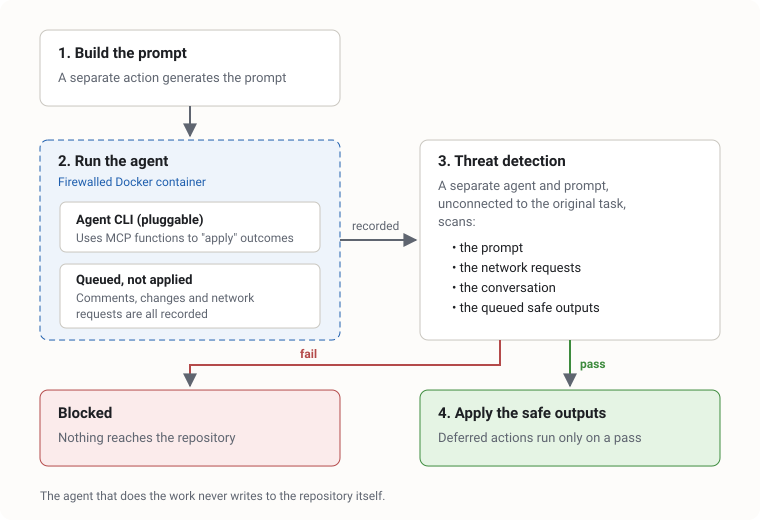

[GitHub Agentic Workflows](https://gh.io/gh-aw) (gh-aw) is a new product from GitHub. It lets you define actions and checks that run AI against changes in your repositories. Yes, another AI thing. This one's actually useful though.

I've used it for a number of things. This post covers how it keeps the agent safe, how I've used it for compliance checks, and a question I think it raises about how we deliver software. The snippets below use sample values, and I've trimmed them with `...` to keep them short.

## Agentic review of code

As the velocity of changes increases, the ability to review that same code needs to scale with it. Human in the loop can only scale so far, not least because the humans need lunch. So to reduce the cognitive overhead on engineers, we use AI to perform broad checks against code.

A workflow is just a Markdown file in `.github/workflows/`. YAML frontmatter at the top says when it runs and what it's allowed to do, and the body is the instructions for the agent:

```markdown
---
on:
  pull_request:
    types: [opened, synchronize]
permissions: read-all
safe-outputs:
  add-comment:
---

# Pull request reviewer

Review the changes in this pull request. Look for bugs, missing tests and
anything that breaks our conventions in CONTRIBUTING.md. ...
Leave one comment with your findings. If there's nothing to say, say nothing.
```

## How it keeps the agent safe

The bit I like most is that the agent never gets the keys to the car. It runs in a sandboxed container, and nothing it does touches your repository directly. It works in layers:



`gh aw compile` turns that Markdown into a normal Actions workflow (a `.lock.yml` file), and each layer becomes its own job. Heavily trimmed, it looks something like this:

```yaml
# pr-reviewer.lock.yml (generated, trimmed)
jobs:
  activation:     # builds the prompt
    ...
  agent:          # runs the agent CLI inside the firewall
    needs: activation
    ...
  detection:      # threat detection: separate agent, separate prompt
    needs: agent
    ...
  safe_outputs:   # applies the queued outputs, only on a pass
    needs: [agent, detection]
    ...
```

1. **Build the prompt.** The prompt is created in a separate action, before any agent runs.
2. **Run the agent in a firewalled container.** The generated prompt is handed to the agent's CLI, running in a firewalled Docker container. You decide what it can reach on the network:

    ```yaml
    sandbox:
      agent: awf          # Agent Workflow Firewall, the default
    network:
      firewall: true
      allowed:
        - defaults
        - "api.example.com"
    ```

    The instructions tell it to use MCP functions to apply outcomes, but those outcomes (comments, changes and so on) are queued rather than applied. The agent thinks it's done the work. It hasn't, yet. Every outbound action is recorded and passed on to the next step.
3. **Threat detection.** The next action scans the prompt, the network requests, the conversation and the queued "safe outputs". It does this with a separate prompt and a separate agent, unconnected to the original task. A second opinion from someone who wasn't in the room. It's on by default whenever you have safe outputs, and you can give it extra things to look for:

    ```yaml
    safe-outputs:
      add-comment:
      threat-detection:
        prompt: "Flag anything that leaks secrets or edits CI config"
    ```

4. **Apply the safe outputs.** Only if threat detection passes do the deferred safe outputs get executed.

So the agent doing the work never writes to the repo itself, and whoever marks its homework has no stake in the original task.

### MCP scripts

Because of this architecture you can use a technique that isn't well known: MCP scripts. They let you define custom actions you want the AI to execute that aren't an MCP server. For example, you might want the agent to run a `.sh` script without handing it a shell and hoping for the best:

```yaml
mcp-scripts:
  check-release-notes:
    description: "Check that a release has release notes"
    inputs:
      tag:
        type: string
        required: true
    run: |
      ./scripts/check-release-notes.sh "$INPUT_TAG"
```

The agent sees `check-release-notes` as just another tool it can call, with a `tag` parameter. MCP scripts follow the same safe outputs pattern.

## How I used it: SDLC compliance

We use a scheduled workflow to break down complex legal SDLC documentation into actionable checks. Each of those checks is an action that gets executed. The instructions are written in plain English, which is handy when the source material is a policy document rather than code:

```markdown
---
on:
  schedule:
    - cron: "0 7 * * 1"     # Monday mornings, before anyone's had coffee
permissions: read-all
safe-outputs:
  create-issue:
...
---

# SDLC conformance check

Read the SDLC policy in docs/sdlc-policy.md and break it down into a list of
concrete checks, for example "every release has release notes" or "every PR
has at least one approving review".

For each check, decide whether this repository passes or fails, and why. ...
Open one issue summarising any failures, with links to the evidence.
```

That gives us a way to actually tell whether a repository is SDLC conformant, without paying for complex third-party systems to answer what are relatively simple questions. Things like "are release notes captured?" or "is anyone actually reviewing these PRs?". With MCP access, the agent can automate these. The GitHub tools are built in, and you can add other MCP servers alongside them:

```yaml
tools:
  github:
    toolsets: [default]     # repos, issues, pull requests ...
mcp-servers:
  policy-docs:
    url: "https://mcp.example.com/sse"
    allowed: ["*"]
```

## How else we use it

We also use it for agentic review. It works well because the AI agent is pluggable, which means less operational risk and less vendor lock-in. Given there are only a handful of providers, putting all your eggs in one basket is a brave move. Switching is one line of frontmatter, which also keeps costs more competitive:

```yaml
engine:
  id: claude            # or copilot, codex, gemini ...
  model: claude-haiku-4-5
```

On cost, gh-aw lets you set budgets. You can put a maximum spend on your hosted workflows without waking up to a bill that looks like a phone number. That helps small businesses and startups as well as established businesses:

```yaml
max-ai-credits: 500           # hard cap for a single run
max-daily-ai-credits: 2000    # per workflow, per day
max-turns: 20                 # stop the agent going round in circles
```

## Looking forward: speed or spend?

This is where it gets interesting for strategy. You can start to do loop-based, controlled AI execution of features: orchestration through GitHub, but in a way where you can control spend.

If AI means the code can be done faster, the limit is really money. So you can control your delivery cadence using money, rather than an uncontrolled explosion of cost. For some companies that predictable cost is better.

But it raises questions about software delivery. In the AI world, is it better to deliver faster and spend more money? Or should we slow down, pay attention to the agents, and observe them at a known rate?

I don't have a neat answer. But faster delivery or controlled spend? That's the question organisations should be asking themselves in 2026.
