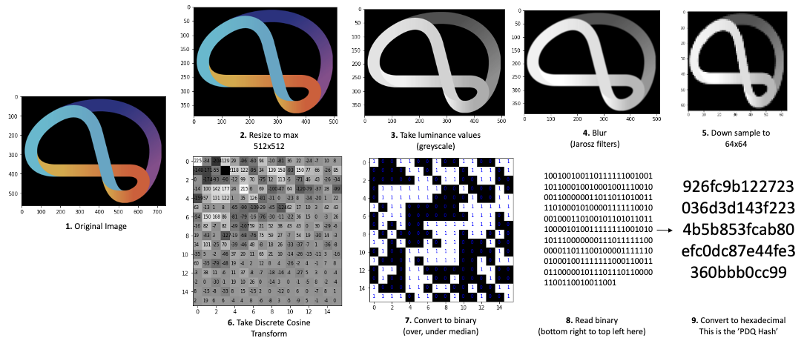
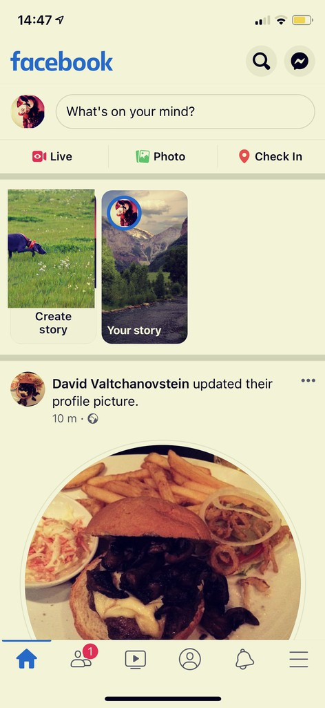
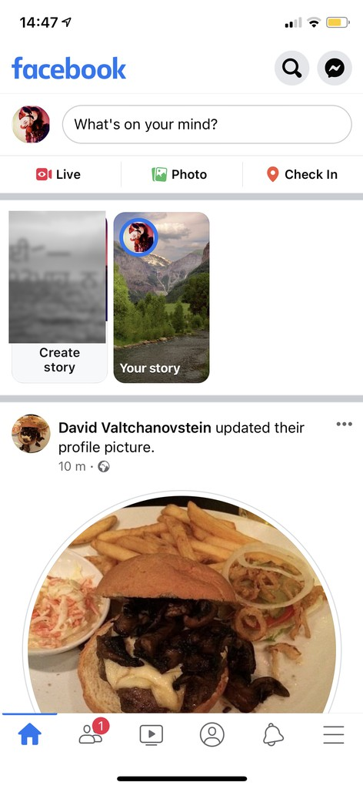
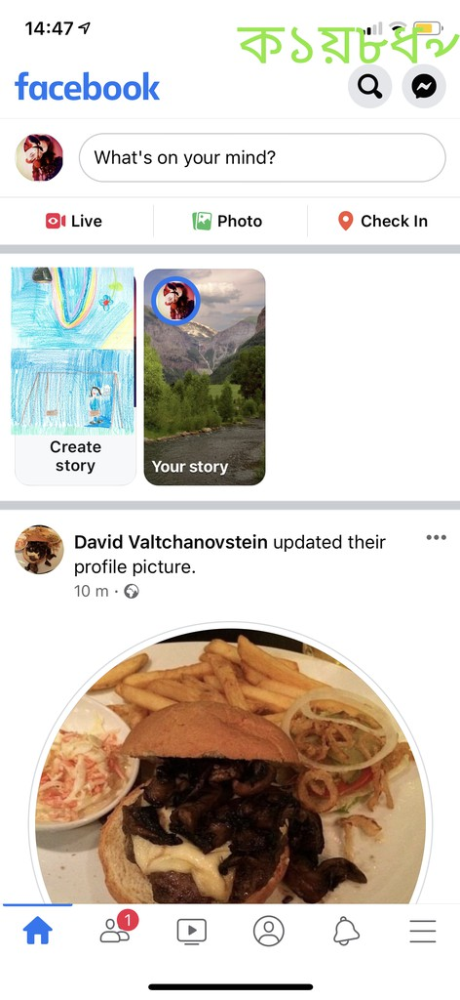
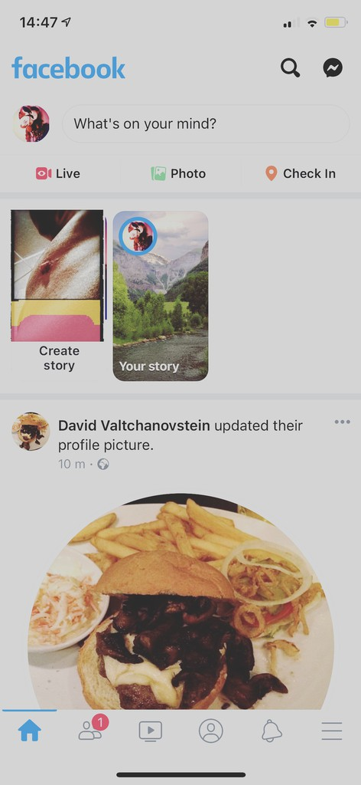
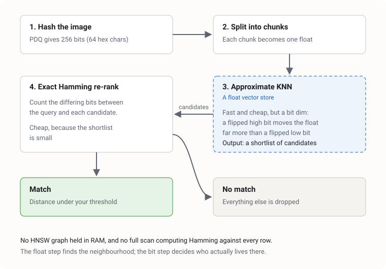

A couple of years ago we open sourced a pure .NET port of Meta's PDQ image hashing algorithm: [PdqHash](https://github.com/crispthinking/PdqHash). I never wrote about it at the time, which is a shame, because the interesting parts weren't really the code. They were how you search these hashes at scale, and what it takes to get a company to let code out of the building.

## Scanning images at hyperscale

If you process data at hyperscale, you need to scan images at hyperscale too. Some of those images are violative: abuse material, terrorist content, the things nobody wants on their platform. Providing a capability for systems to check images at that volume gets expensive quickly.

The obvious 2026 answer is "send it to an AI model". But most AI providers' terms of service say you shouldn't send them violative images in the first place, which rather limits that plan. So the industry leans on something older and less glamorous: hash matching. You hash the image, and compare it against hashes of known bad content.

## PhotoDNA, PDQ and ThreatExchange

The long-standing option is Microsoft's PhotoDNA. It works well, but it's proprietary and gated: you apply for access and you don't get the source.

Meta went the other way. In 2019 they open sourced [PDQ](https://github.com/facebook/ThreatExchange/tree/main/pdq), a perceptual hash, alongside [ThreatExchange](https://developers.facebook.com/docs/threat-exchange/), which lets vendors and platforms exchange hashes of known content.

Why not just use MD5 or SHA-256? Because cryptographic hashes are built so that changing a single pixel changes the whole hash. Resize, recompress or screenshot a known image and, as far as MD5 is concerned, it's a brand new file. A perceptual hash wants the opposite: a small change to the image should make a small change to the hash.

PDQ turns an image into a 256-bit hash. Roughly: convert to greyscale, blur, downsample to 64x64, run a discrete cosine transform down to 16x16, then set each bit by whether that value is above or below the median. Darwinium's diagram shows it better than I can:



*Diagram from Darwinium's [Rust implementation of PDQ](https://github.com/darwinium-com/pdqhash) (Apache 2.0), which has a great visual walkthrough of how the hash works.*

Two visually similar images produce hashes that differ in only a few bits, and you measure that with Hamming distance: count the bits that differ. Meta's own tooling treats a distance of 31 or less as a confident match.

Here are four images from Meta's [DISC21](https://ai.meta.com/datasets/disc21-dataset/) dataset, which we use in our tests. They're all edits of the same screenshot:

| A | B | C | D |
| --- | --- | --- | --- |
|  |  |  |  |

Split into pairs of hex characters, with the pairs that differ from A in bold:

**A** (distance 0): 10 3b 7f d4 73 da 59 e4 1f 92 5f 48 45 e6 02 57 44 cd 1c 99 98 24 b3 e6 fa 74 46 1b 0e 99 fb 64

**B** (distance 14): 10 3b **ff** d4 73 da **51** **e7** **17** **93** 5f 48 **47** **f6** 02 **53** **40** cd 1c 99 98 **04** b3 **ee** fa 74 **44** 1b 0e 99 **bb** 64

**C** (distance 20): **52** 3b **ff** **c4** 73 da 59 e4 **57** **d2** 5f 48 **47** **f6** 02 **53** **45** **c9** **1e** 99 **90** **04** **91** **a6** fa 74 **4e** **19** 0e 99 fb 64

**D** (distance 38): **12** **33** **7e** **f4** **7b** **d8** **5d** e4 **07** 92 **1f** **49** **c5** **a7** **52** **73** **64** cd **3c** **98** **18** **34** **93** **a6** **f2** **65** **e4** **0b** **2c** 99 **9b** **f4**

There's no ML model behind the scenes and no semantic meaning. PDQ doesn't know that both pictures contain a cat. But it works for catching known images that have been resized, and because it's just maths rather than a model, it's very fast.

So sharing hashes is a solved problem. Searching them isn't.

## Searching hashes without a binary vector database

Comparing two hashes is trivial. Comparing one hash against millions, quickly, is not. What you really want is a binary vector database: something that indexes bit strings and searches by Hamming distance, across many servers.

At the time, the options were thin. FAISS has binary indexes, but it's a library rather than a server, and the index lives in RAM on a single node. Redis vector search is floats only. pgvector had only just added a bit type with Hamming distance. Most embeddings these days are floating point, so that's where the tooling is.

So we went with an approximate approach on a float vector store instead:



1. **Hash the image** with PDQ.
2. **Split the hash into chunks** of two hex characters and treat each chunk as a floating point number. The hash becomes a small float vector:

    ```text
    A   10  3b  7f  d4  73  da ...   ->   [16, 59, 127, 212, 115, 218, ...]
    B   10  3b  ff  d4  73  da ...   ->   [16, 59, 255, 212, 115, 218, ...]
    ```
3. **Run an approximate KNN query** (k-means style) against the float vector store. This gives you a shortlist of candidates that are probably close.
4. **Do an exact Hamming distance check** over the shortlist, and keep the ones under your match threshold.

The float projection isn't distance-preserving, and I want to be honest about that. Flip a high bit in a chunk and the float moves a long way: `7f` to `ff` above is one flipped bit, but the value jumps from 127 to 255. Flip a low bit and it barely twitches. So the float search is a candidate filter that will occasionally miss things, and the exact Hamming check on the way out is what gives you accuracy.

What you get in return is fast, maths-based retrieval of similar items, without running an HNSW graph that wants the whole thing in RAM, and without a full database scan to compute Hamming distance against every row. The float step finds the neighbourhood. The bit step decides who actually lives there.

## Porting PDQ to .NET

Figuring all that out meant we could use PDQ at work, and parts of our stack use .NET. Meta's reference implementations don't include C#. So we wrote one, and decided to publish it for other companies on .NET to use. A small tech-for-good contribution, and one less excuse for a platform not to hash its images.

The algorithm itself isn't much code. Getting it to agree with Meta's is the hard part. The first step of PDQ is to load and downscale the image, and different image libraries do that differently. Resampling filters, colour channel handling, the type of the intermediate values, the order of operations: each one nudges the result. Nudge enough of them and your "PDQ" hash is now a PDQ-flavoured hash that doesn't match anyone else's.

So the verification is automated. CI installs Meta's reference `threatexchange` Python tooling, hashes a set of sample images from the [DISC21](https://ai.meta.com/datasets/disc21-dataset/) dataset with both implementations, and compares them:

```csharp
var distance = result.Hash.hammingDistance(referenceHash);

Assert.InRange(distance, 0, MAX_REFERENCE_DISTANCE);
```

Meta's guidance for implementations is to stay within a distance of 10 of the reference. We got it to zero. It's now listed as the C# implementation in [Meta's PDQ README](https://github.com/facebook/ThreatExchange/tree/main/pdq).

It also supports vPDQ, the video variant, if you need to hash video frames too.

## Getting it out the door

Writing the code was the quick bit. Open sourcing it took longer.

Not because the company didn't want to. Everyone was supportive. It was that the company needed the legal wiring to do it properly, and that wiring didn't exist yet. Two things took the time:

- **The licence.** Which one, what it commits the company to, and what it doesn't.
- **Assignment.** Who owns the copyright, which in our case meant assigning it to the parent company.

Answering those once wasn't enough. We had to write an open source policy, our agreed approach for this and future projects, and get it signed off by legal counsel. That involved legal, the CTOs and a fair few other stakeholders, and none of it involved writing code.

So if you're ever frustrated that your company won't open source your work, it's probably not that they don't want to. It's that someone has to work out the licence, the ownership and the policy, and get a lawyer to put their name to it. If you want it to happen, offer to help write the policy. You'll be surprisingly popular.

The code is at [github.com/crispthinking/PdqHash](https://github.com/crispthinking/PdqHash) and on NuGet. If you're on .NET and need perceptual hashing, have a look.
